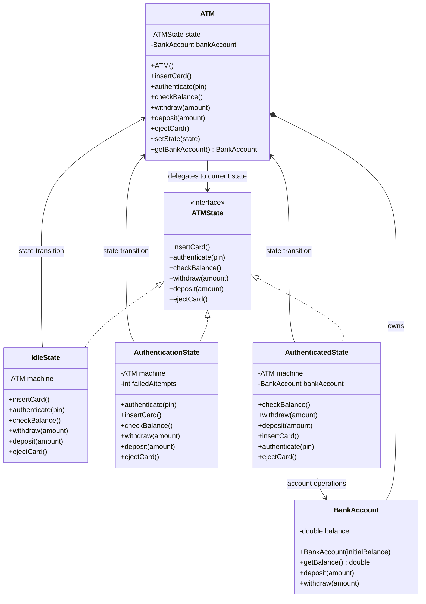
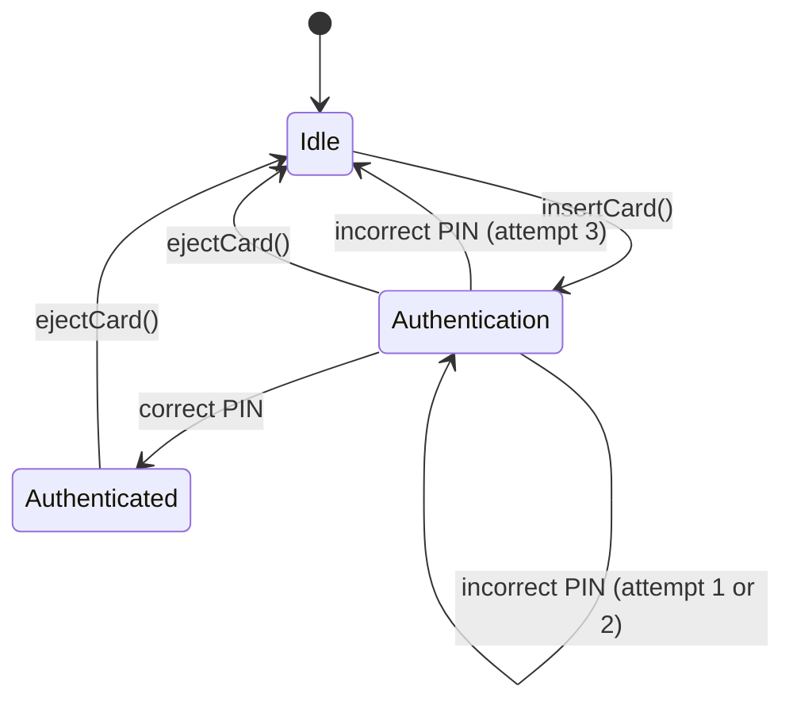
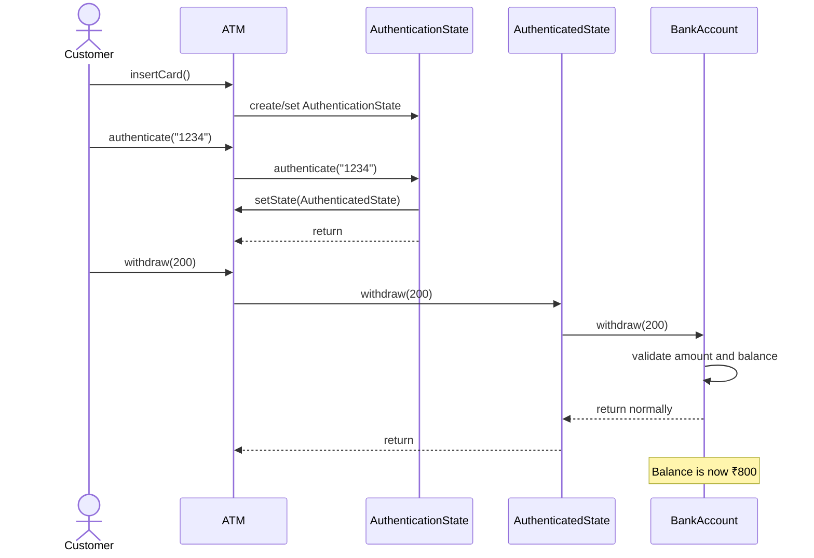
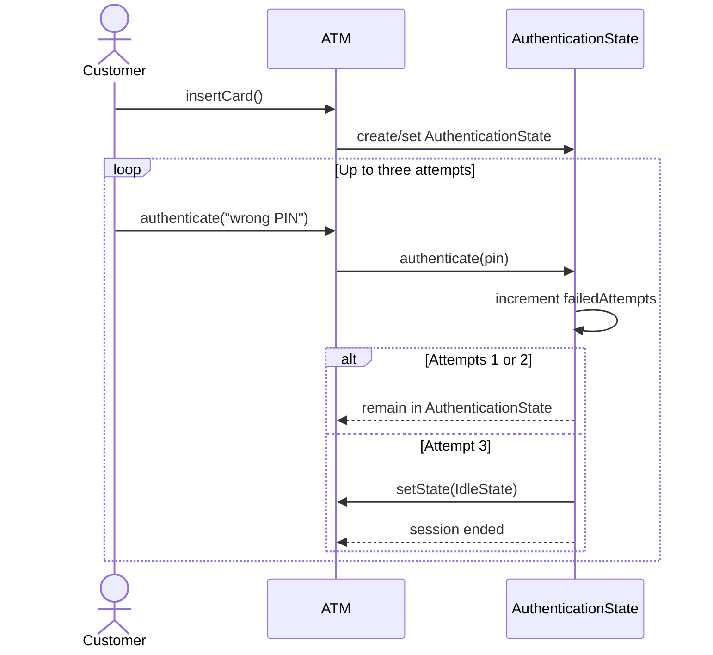

yo# ATM System — Low-Level Design

A small, state-pattern-based ATM simulation implemented in Java.

## 1. Scope and requirements

The implementation supports:

- Insert a card to begin a session.
- Authenticate using a PIN.
- Allow up to three incorrect PIN attempts; the third failure ends the session and returns the ATM to `IdleState`.
- Check account balance after successful authentication.
- Deposit a positive, finite amount.
- Withdraw a positive, finite amount when sufficient funds are available.
- Eject the card to end the session.
- Reject operations that are invalid for the current state.
- Keep the account balance across sessions.

### Simplifications

- The PIN is hardcoded as `1234` for this learning exercise.
- The ATM uses one simulated account with an initial balance of ₹1,000.
- Cash inventory, physical cards, bank/network communication, persistence, and concurrent sessions are not modeled.
- `double` is used for simplicity. Real financial systems should use integer minor units or `BigDecimal`.

## 2. State pattern and architecture

`ATM` delegates each user operation to its current `ATMState`. Each concrete state defines which operations are valid and how the machine transitions to another state.

### Class diagram



## 3. State-transition diagram



## 4. Sequence diagram — successful withdrawal

This sequence assumes the user has entered the correct PIN and withdraws ₹200 from the initial ₹1,000 balance.



## 5. Sequence diagram — third incorrect PIN



## 6. Main flow

1. The ATM starts in `IdleState`.
2. `insertCard()` changes the current state to `AuthenticationState`.
3. `authenticate(pin)` checks the PIN. A correct PIN transitions to `AuthenticatedState`; the third incorrect PIN transitions to `IdleState`.
4. In `AuthenticatedState`, the customer can check balance, deposit, or withdraw.
5. `ejectCard()` ends the session and transitions to `IdleState`.
6. `BankAccount` validates deposits and withdrawals. A withdrawal above the current balance throws an exception and does not deduct funds.

## 7. Edge cases covered by the current test run

The user ran the `Main`-based test flow and reported that all cases completed successfully.

| Test | Expected behavior |
|---|---|
| Normal flow | Authenticate, check balance, deposit, check updated balance, eject, and authenticate again |
| Three incorrect PIN attempts | Session ends after the third failure; balance access is rejected while idle |
| Insufficient balance | Withdrawal is rejected and balance remains unchanged |
| Zero deposit | Rejected |
| Negative deposit | Rejected |
| Zero withdrawal | Rejected |
| Negative withdrawal | Rejected |
| Balance check while idle | Rejected |
| Withdrawal while idle | Rejected |
| Deposit while idle | Rejected |

The current `Main` test harness reports `PASS` messages when expected exceptions are observed. It is a lightweight console-based test harness, not a JUnit suite.

## 8. Suggested project structure

```text
src/
└── atm/
    ├── ATM.java
    ├── ATMState.java
    ├── IdleState.java
    ├── AuthenticationState.java
    ├── AuthenticatedState.java
    ├── BankAccount.java
    └── Main.java
README.md
```

## 9. Running the program

From the directory containing `src/`, compile and run:

```bash
javac -d out src/atm/*.java
java -cp out atm.Main
```

If your Java files are directly inside a package folder rather than `src/atm/`, adjust the compile path accordingly.

## 10. Design notes and future improvements

- **State pattern:** Keeps state-dependent behavior in separate classes rather than accumulating conditionals in `ATM`.
- **Single account owner:** `ATM` owns the `BankAccount`, so the balance persists when the state object changes.
- **Explicit invalid operations:** Methods unavailable in a state throw `IllegalStateException`.
- **Input validation:** Deposit and withdrawal amounts must be finite and greater than zero; insufficient funds are rejected.
- **Possible next improvements:** add a cash dispenser and ATM cash inventory, model card retention/lockout explicitly, separate transaction results from console output, introduce a `PinValidator`/bank service, use `BigDecimal` or integer cents, and add JUnit tests.

## 11. Suggested Git commit

```text
Implement ATM LLD using State pattern with validation and flow tests
```
