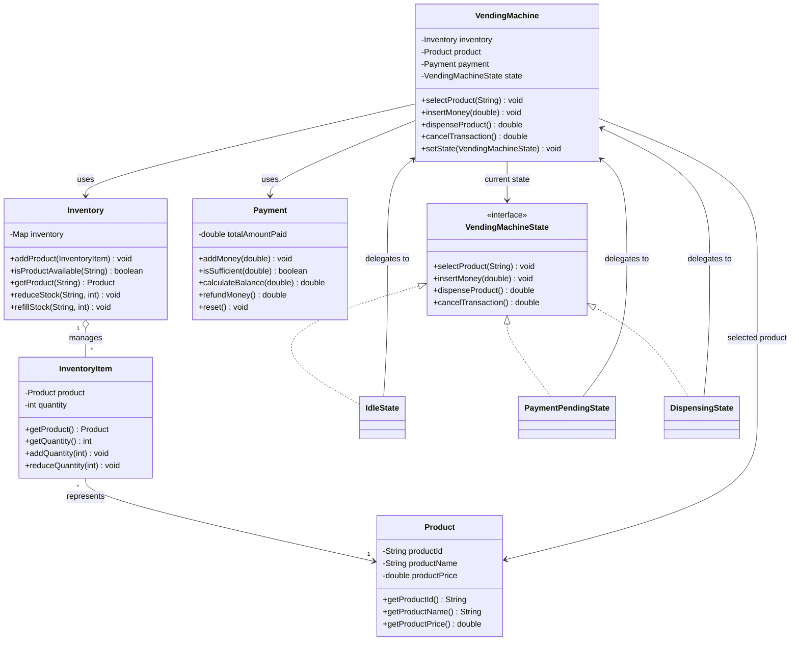
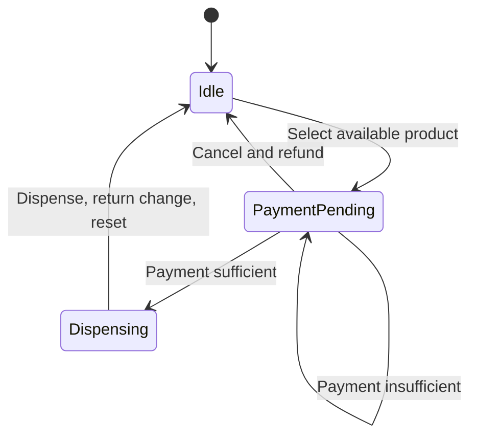

# Vending Machine System — Low-Level Design

## 1. Overview
A simplified Java vending machine demonstrating object-oriented design and the **State Design Pattern**. A customer can select an available product, insert money, purchase it when payment is sufficient, receive change, or cancel before dispensing and receive a refund.

## 2. Functional requirements
- Maintain products by unique ID, name, price, and stock quantity.
- Select available products.
- Accept incremental payments and check payment sufficiency.
- Dispense a product after sufficient payment.
- Calculate and return change.
- Cancel while payment is pending and refund accumulated payment.
- Reset the transaction after purchase or cancellation.
- Reject operations that are invalid in the current state.

## 3. Scope and assumptions
**In scope:** one machine, product selection, inventory management, payment accumulation, dispensing, change, cancellation/refund, and state validation.

**Out of scope:** payment gateway integration, physical cash hardware, persistence, remote inventory, multiple machines, authentication/UI, concurrency, and detailed recovery from hardware failures.

**Assumptions:** product IDs are unique; a product must exist and be in stock before selection; each transaction selects one product; payments may be incremental; change is returned; cancellation is supported while payment is pending; successful purchase/cancellation returns the machine to idle.

## 4. Architecture and responsibilities

| Component | Responsibility |
|---|---|
| `Product` | Product ID, name, and price |
| `InventoryItem` | Product reference and quantity |
| `Inventory` | Store inventory items and manage stock |
| `Payment` | Accumulate payment, check sufficiency, calculate change, refund/reset |
| `VendingMachine` | Coordinate transaction and maintain current state |
| `VendingMachineState` | Interface for state-dependent operations |
| `IdleState` | Handle product selection |
| `PaymentPendingState` | Handle payment, insufficient funds, and cancellation |
| `DispensingState` | Complete purchase, update stock, calculate change, reset |

## 5. UML class diagram

The diagram is available as `diagrams/class-diagram.svg` and the editable Mermaid source as `diagrams/class-diagram.mmd`.



## 6. State Design Pattern

### Why it is used
The machine behaves differently according to its current state. Product selection is allowed while idle, payment is accepted while payment is pending, and dispensing completes the purchase. Without the pattern, state-dependent conditional logic can accumulate in the context. The State Pattern encapsulates that behaviour in concrete state classes.

### Participants
- **Context — `VendingMachine`:** holds the current `VendingMachineState` and delegates operations.
- **State interface — `VendingMachineState`:** defines `selectProduct`, `insertMoney`, `dispenseProduct`, and `cancelTransaction`.
- **Concrete states:** `IdleState`, `PaymentPendingState`, and `DispensingState`.

Example delegation:
```java
public void insertMoney(double amount) {
    state.insertMoney(amount);
}
```

### State-transition diagram
See `diagrams/state-transition-diagram.svg`; editable source: `diagrams/state-transition-diagram.mmd`.



### Purchase flow
1. Machine starts in `IdleState`.
2. Customer selects a product.
3. Machine verifies the product exists and is in stock.
4. The product is stored and the machine enters `PaymentPendingState`.
5. Money is added to the payment total.
6. If payment is insufficient, the state remains `PaymentPendingState`.
7. If payment is sufficient, the machine enters `DispensingState`.
8. Change is calculated and inventory stock is reduced.
9. Payment and product selection are reset.
10. Machine returns to `IdleState`.

### Cancellation flow
The customer cancels while in `PaymentPendingState`. The machine refunds accumulated payment, clears the selected product, and returns to `IdleState`. Cancellation during dispensing is rejected by the current implementation.

### State Pattern vs enum

| Enum-based approach | State Pattern |
|---|---|
| States are enum constants. | States are objects implementing an interface. |
| Behaviour often relies on conditionals. | Concrete state classes encapsulate behaviour. |
| Simpler for small state machines. | Useful when state-dependent behaviour grows. |
| Conditionals can concentrate in the context. | Behaviour is distributed among state classes. |

The State Pattern adds classes and object creation; use it when the separation is worth the extra complexity.

## 7. SOLID principles

### Single Responsibility Principle (SRP)
`Product` represents product data; `InventoryItem` tracks quantity; `Inventory` manages stock; `Payment` manages payment calculations; `VendingMachine` coordinates transactions; concrete states manage behaviour for their respective states.

### Open/Closed Principle (OCP)
The `VendingMachineState` abstraction allows new states to be introduced without necessarily modifying existing state classes. For example, `MaintenanceState` could reject customer operations. However, setup or transition logic may still need changes, so OCP is not guaranteed completely.

### Liskov Substitution Principle (LSP)
Each concrete state implements the `VendingMachineState` contract. Operations invalid in a particular state should reject calls consistently with the documented contract. `IllegalStateException` is appropriate for explicitly invalid operations.

### Interface Segregation Principle (ISP)
Every state implements the four operations in the shared interface, even though some are invalid in certain states. This is a reasonable trade-off for a small state machine. Revisit the interface if it grows substantially; avoid splitting it into many tiny interfaces without a real need.

### Dependency Inversion Principle (DIP)
`VendingMachine` stores its current state through the `VendingMachineState` abstraction instead of separate fields for concrete states. Concrete state instances are still created during transitions, so the design uses an abstraction but is not fully decoupled from concrete state construction.

## 8. Other principles and patterns
- **Encapsulation:** fields are private and inventory changes go through methods.
- **Separation of concerns:** product data, inventory, payment, and state-specific behaviour are separated.
- **Dependency Injection:** `Inventory` is supplied through the `VendingMachine` constructor. DI is related to, but distinct from, DIP.
- **Composition:** the machine uses inventory and payment objects; inventory manages items that reference products.
- **Strategy Pattern (possible extension):** interchangeable payment methods such as cash, UPI, and cards could use a payment abstraction. State changes behaviour based on current state; Strategy selects an interchangeable algorithm/policy.

## 9. Complexity analysis
Let `n` be the number of products in the `HashMap`.

| Operation | Average time | Additional space |
|---|---:|---:|
| Add/find product | O(1) | O(1) |
| Check availability | O(1) | O(1) |
| Reduce/refill stock | O(1) | O(1) |
| Select product | O(1) | O(1) |
| Insert payment | O(1) | O(1) |
| Calculate change | O(1) | O(1) |
| Dispense | O(1) | O(1) |
| Cancel/refund | O(1) | O(1) |
| Store inventory | — | O(n) |

Average-case O(1) assumes expected constant-time hash-map operations. Collisions can degrade performance; Java `HashMap` may treeify heavily collided buckets, making its worst-case behaviour more nuanced than the traditional O(n) hash-table explanation. The transaction itself requires O(1) additional space, excluding inventory.

## 10. Testing
The existing test suite passed all 17 test cases after the State Pattern refactor. Verify the exact mapping against the repository's test files before claiming each scenario has a dedicated test.

Suggested coverage:
- Valid/invalid product data, duplicate IDs, availability, stock reduction/refill, and preventing negative stock
- Valid, unknown, and out-of-stock product selection
- Invalid operations in each state
- Valid/invalid payments, insufficient payment, and incremental payment
- Successful dispensing, stock decrement, change, and transaction reset
- Cancellation refund, product clearing, return to idle, and invalid-state cancellation

## 11. Potential improvements
- Replace `double` with `BigDecimal` or integer minor units (paise) for money.
- Handle physical dispenser failures and define compensating refund/inventory behaviour.
- Centralise transition validation if the state machine grows.
- Add persistence for inventory and transactions.
- Protect inventory updates against concurrent transactions.
- Add a payment abstraction if multiple payment methods are introduced.
- Add structured logs, transaction IDs, and metrics.

## 12. Conclusion
This project demonstrates object-oriented design and the State Pattern by separating state-specific behaviour from the vending-machine context. It also provides practice with SOLID principles, dependency injection, encapsulation, testing, and complexity analysis. The State Pattern is most valuable when state-dependent behaviour justifies separate state classes.
